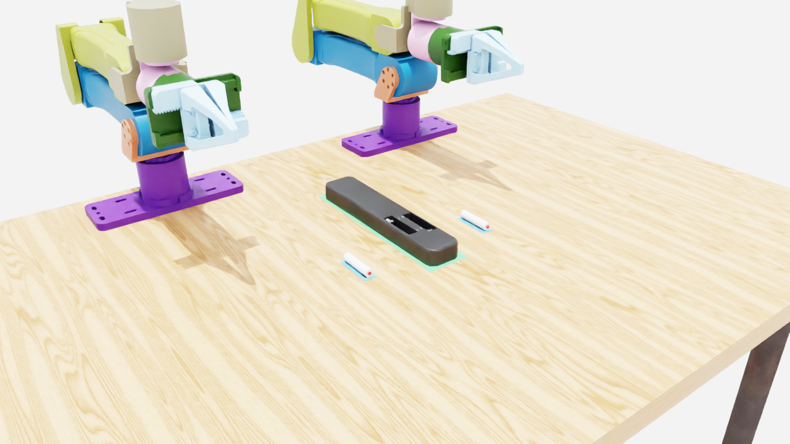
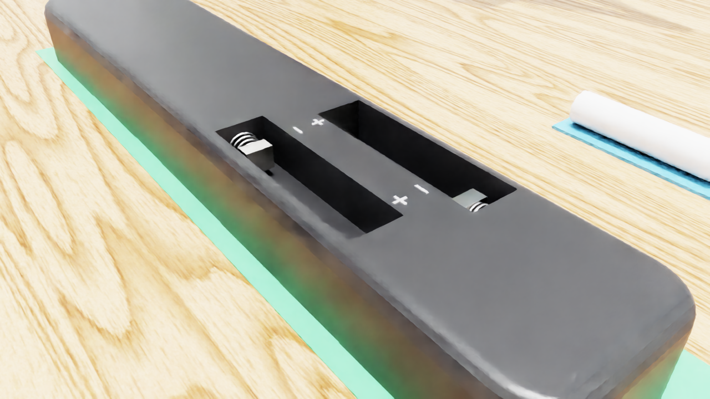
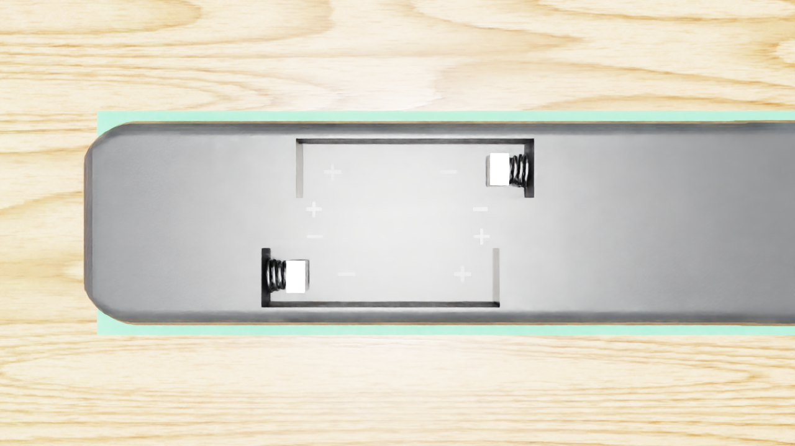
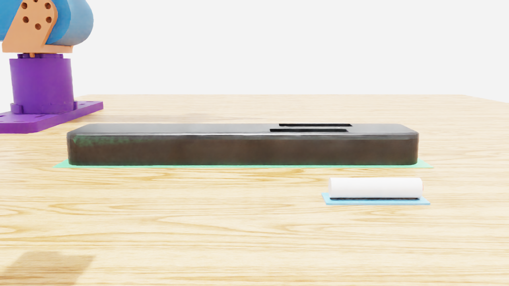
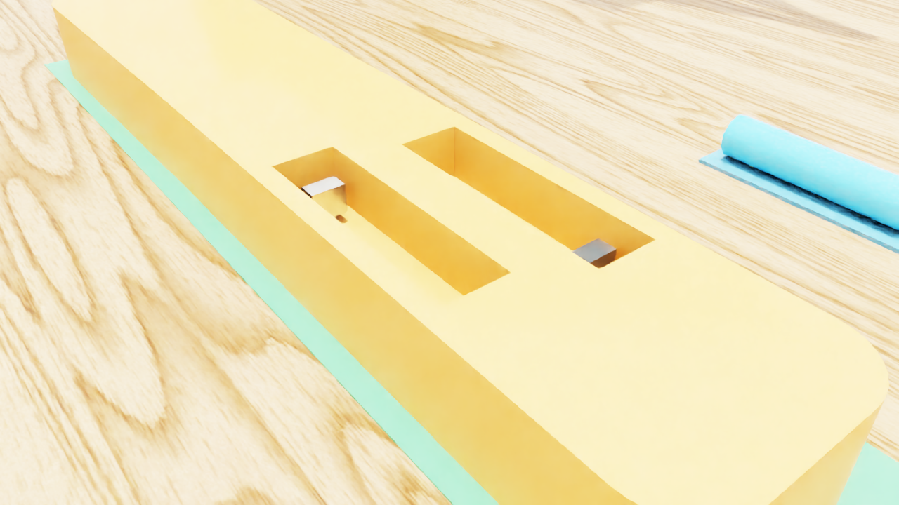
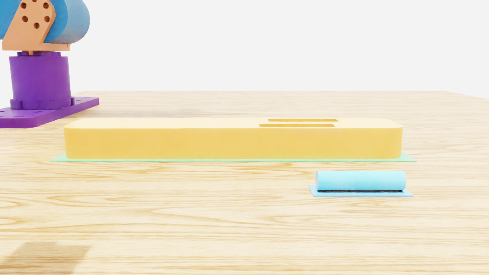

# Proof of life

Renders and measurements from server runs on the L40S (Isaac Lab 17.0.2 / Kit 110.3). Each task's `STATUS.md` has the full record and the code revision each result was taken at.

## Battery remote (`environments/battery-remote`)

Scene at the start: two YAM arms on the maple table, the secured face-down remote with its cover off, and both AAA cells on their marked mats (`tools/physics_check.py`, revision 9bd03ef).

The open two-AAA bay: nickel contact and coil spring at the correct end of each slot, moulded `+`/`-` marks.

Collision geometry (visuals hidden): the guide-only shell colliders and the two spring plungers.

Measured on the server:

- `tools/physics_check.py`: the remote fixture holds (0.004 mm); with no cell each spring follows a 3.92 mm target and returns to 0; a cell lowered into either slot and released stays seated (axial offset 0.00 mm, spring contact, 1.46 mm compression); a reversed cell is rejected; cells stay on their mats at the start (1.4 mm settle drift).
- `tools/reach_check.py` at be1f60b, the real YAM arm under scripted IK: the left arm brought its fingertips within 2.1 mm of battery_b with the gripper 3° from vertical and the fingers across the cell, closed on it (pad gap 29.1 mm vs 24.0 mm closed on nothing) and **lifted it 64 mm**. The right arm's grasp of battery_a ended 39.5 mm off and did not lift.
- `launch_battery_insertion.py`: the Arena runner completes 50 zero-action steps with no false failure.

## Chess and nut

Chess renders (board, pieces, colliders) were reviewed during development (`tools/render_check.py`) and will be added here from the next server run. The nut scene is being switched to Isaac Lab's Factory M16 nut and bolt; its images will follow that change.
